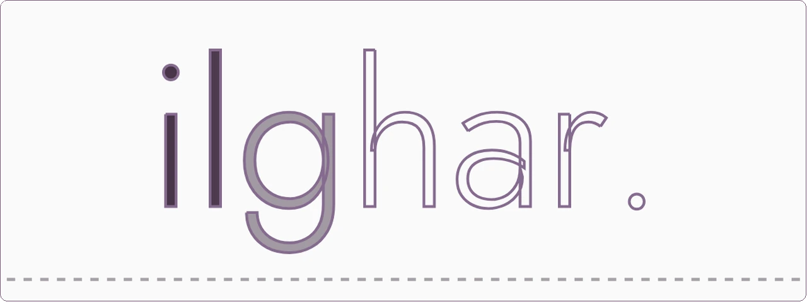
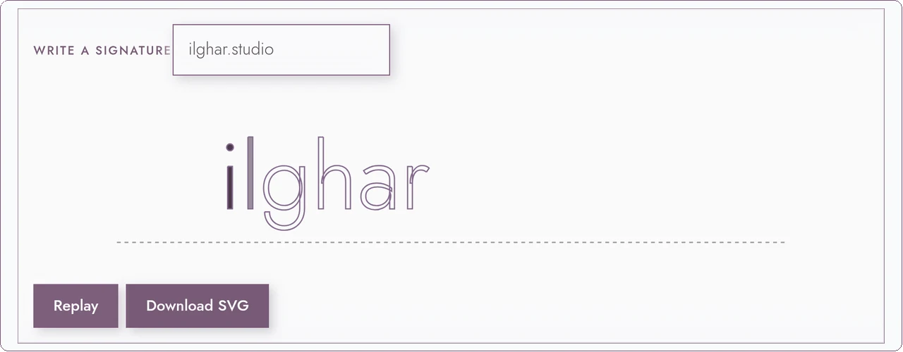
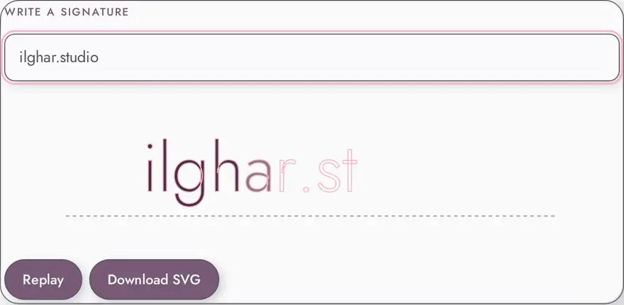

  <a href="https://ilghar.github.io/signature-typography/">
    <picture>
      <source media="(prefers-color-scheme: dark)" srcset="docs/hero/hero-dark.webp">
      
    </picture>
  </a>

A signature field you type into, so a name can be traced, settled in ink, and downloaded as SVG.

<a href="https://ilghar.github.io/signature-typography/">Open the live app</a> · <a href="https://github.com/Ilghar/signature-typography">Repository</a> · <a href="https://ilghar.studio">ilghar.studio</a>

| <a href="https://ilghar.github.io/signature-typography/"><picture><source media="(prefers-color-scheme: dark)" srcset="docs/hero/f1-dark.webp"></picture></a> | <a href="https://ilghar.github.io/signature-typography/"><picture><source media="(prefers-color-scheme: dark)" srcset="docs/hero/f2-dark.webp"></picture></a> |
|---|---|

## How it works
- Type, paste, or compose into the real text field.
- Text is sanitized, split into graphemes, and drawn as SVG strokes that then fill.
- You get the animated signature on the canvas, with optional SVG download.

ilghar.studio
