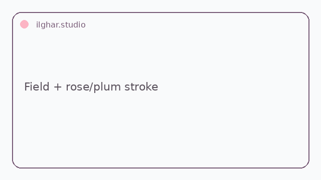
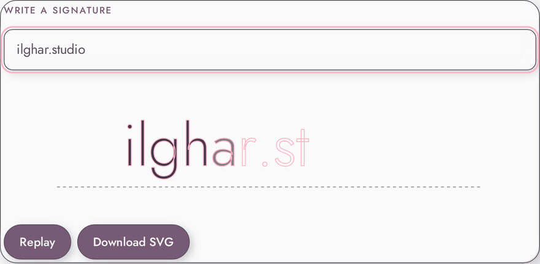

<!-- Copy to the top of every README. Replace REPO, files in docs/hero/. -->

  <a href="https://ilghar.github.io/signature-typography/">
    <picture>
      <source media="(prefers-color-scheme: dark)" srcset="docs/hero/hero-dark.svg">
      
    </picture>
  </a>

<b><a href="https://ilghar.github.io/signature-typography/">OPEN THE LIVE APP</a></b> | <a href="#how-it-works">HOW IT WORKS</a>

<!-- Function previews: one per app function, GIF/SVG, each linking into the live app -->
| <picture><source media="(prefers-color-scheme: dark)" srcset="docs/hero/f1-dark.gif"></picture> | <picture><source media="(prefers-color-scheme: dark)" srcset="docs/hero/f2-dark.gif"></picture> |
|---|---|

## How it works
- Type, paste, or compose into the real text field.
- Text is sanitized, split into graphemes, and drawn as SVG strokes that then fill.
- You get the animated signature on the canvas, with optional SVG download.

ilghar.studio
